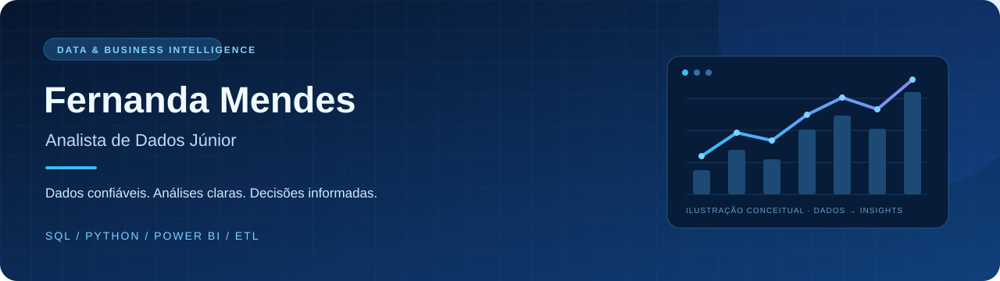

  

  
  
  

Olá, eu sou a Fernanda!
Sou graduanda em Engenharia de Software e técnica em Desenvolvimento de Sistemas, com experiência de estágio em análise e desenvolvimento de dados. Meu foco é conectar SQL, Python e Power BI para organizar dados, investigar inconsistências e construir análises úteis para o negócio.
Na minha experiência com dados, executei consultas em SQL/PL-SQL, apoiei pipelines e processos ETL/ELT e contribuí com validação, relatórios, dashboards e documentação de rotinas.
Interesses: análise de dados, Business Intelligence e integração de dados.
Base técnica: SQL avançado, modelagem de dados e Python aplicado à análise.
Em formação: Engenharia de Dados pela Alura e Ciência de Dados pelo Santander Open Academy.
Idiomas: inglês avançado em comunicação oral, leitura e escrita.
Localização: Lins, São Paulo.
> Gosto de entender o caminho dos dados: de onde vêm, como são tratados e quais perguntas podem responder.
Tecnologias e conhecimentos

  
  
  
  
  
  

Área	Conhecimentos
SQL e bancos relacionais	JOINs, CTEs, manipulação de dados, otimização de consultas, SQL/PL-SQL e MySQL; conhecimentos em PostgreSQL.
Python e análise	Pandas, ingestão, limpeza, transformação e processamento de dados.
Modelagem de dados	Modelagem conceitual, lógica, física e dimensional; esquema estrela e Data Warehouse.
Business Intelligence	Power BI, dashboards, relatórios e indicadores de desempenho.
Integração e qualidade	Pipelines, ETL/ELT, validação de dados, investigação de inconsistências e documentação.
Cloud	Conhecimentos em Azure e AWS.
Projetos em destaque
01 · Pipeline de Dados de Vendas — Olist
Como organizar dados de vendas para análise?
Desenvolvi um pipeline de ingestão, limpeza e transformação, com armazenamento em MySQL e visualização no Power BI. Modelei os dados em esquema estrela, preparando a estrutura para consultas analíticas e indicadores de vendas.
Foco técnico: Python · Pandas · MySQL · Modelagem dimensional · Power BI
---
02 · Operational KPI Analytics
Como acompanhar uma operação e investigar gargalos?
Estruturei análises de SLA, FCR, CSAT, produtividade e backlog e desenvolvi um dashboard gerencial para acompanhar resultados e apoiar a investigação de gargalos operacionais.
Foco técnico: Python · SQL · Pandas · Power BI · Indicadores operacionais
---
03 · Automação de Processos para Empresa Financeira

Desenvolvo scripts Python para extração e processamento de dados, com integração ao MySQL, aplicação de processos ETL/ELT e construção de KPIs no Power BI.
Foco técnico: Python · MySQL · ETL/ELT · Power BI
---
04 · Credit Risk Data Pipeline & Analytics

Desenvolvo processos de ingestão, validação e transformação de dados de crédito, com indicadores de risco e inadimplência para análise.
Foco do projeto: qualidade de dados · pipelines · indicadores de risco

  <a href="https://github.com/rafsfer?tab=repositories"><strong>Explorar meus repositórios →</strong></a>

Formação
Bacharelado em Engenharia de Software — Unilins · 2025–2029 · Em andamento.
Técnico em Desenvolvimento de Sistemas — Etec de Lins / Centro Paula Souza · 2022–2024.
Engenharia de Dados — Alura · Em andamento.
Ciência de Dados — Santander Open Academy · Em andamento.
Vamos conversar sobre dados?
Tenho interesse em oportunidades como Analista de Dados Júnior, com foco em SQL, Python, Power BI e construção de informações confiáveis para apoiar decisões.
LinkedIn · E-mail
---

SQL para explorar · Python para transformar · Power BI para comunicar

